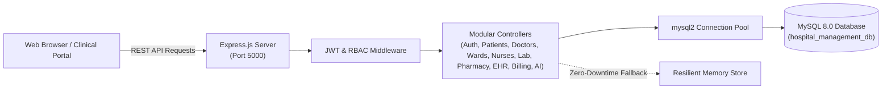

# Hospital Management System (HMS)

[](https://nodejs.org/)
[](https://expressjs.com/)
[](https://www.mysql.com/)
[](https://jwt.io/)
[](LICENSE)

An enterprise-grade, production-oriented Hospital Management System (HMS) engineered to orchestrate clinical outpatient workflows, inpatient bed matrix telemetry, nursing vital signs intake, laboratory diagnostics, pharmacy formulary inventory, electronic health records (EHR), automated revenue billing, and context-aware clinical AI assistance.

---

## 📌 Project Overview

Modern healthcare facilities demand seamless, real-time coordination between patient registration, consultation suites, nursing stations, critical care wards, diagnostic pathology laboratories, and billing desks. The **Hospital Management System (HMS)** delivers a unified digital workspace designed to eliminate administrative bottlenecks, enforce strict Role-Based Access Control (RBAC), ensure HIPAA/NABH data compliance, and provide patients with intelligent, bilingual healthcare support.

The system features an asynchronous RESTful backend built with Node.js and Express, backed by a normalized relational MySQL schema with connection pooling, and paired with a responsive medical dashboard UI.

---

## 🚀 Enterprise Features

- **Executive KPI Dashboard**: Real-time telemetry tracking total patient census, daily scheduled appointments, on-duty consulting doctors, ward occupancy metrics, and settled OPD revenue.
- **Strict Multi-Role Authentication & RBAC**: Real password verification with salted `bcryptjs` hashing (10 rounds), signed JSON Web Tokens (JWT), normalized email uniqueness constraints, and 1-hour time-limited recovery reset tokens.
- **Inpatient Wards & Real-Time Bed Matrix**: Live visual occupancy grid tracking beds across Intensive Care Units (ICU), Cardiology CCU, General Wards (Male/Female), and Post-Op Recovery with 1-click patient allocation and discharge status updates.
- **Nurse Station & Vital Signs Telemetry**: On-duty shift rosters paired with a physiological telemetry intake form (Blood Pressure, Heart Rate, SpO2 %, Temperature, Respiratory Rate, Blood Glucose) and historical logging.
- **Diagnostic Laboratory Hub**: Test catalog across hematology, biochemistry, and pathology panels with digital workorders, specimen tracking, and pathologist result sign-offs.
- **Pharmacy Formulary & Auto-Dispensing**: Real-time formulary inventory with automated low-stock warnings, batch/expiry tracking, and prescription dispensing that auto-decrements stock quantities.
- **Patient Intake & Registry**: Comprehensive demographics management with unique identifiers (`PAT-XXXX`), blood group tracking, known allergy alerts, emergency contacts, and insurance carrier logs.
- **Smart Appointment Scheduling**: Outpatient slot booking with conflict-free scheduling, automated token generation, and dynamic status progression (`Scheduled` &rarr; `Checked-In` &rarr; `In-Consultation` &rarr; `Completed`).
- **Electronic Health Records (EHR)**: Clinical consultation notes, diagnostic summaries, vital sign telemetry, and digital prescription management.
- **Billing & Revenue Ledger**: Itemized invoice calculation with automated discounts, taxes, net amounts, and multi-mode payment settlement tracking (UPI, Cards, Cash, Insurance).
- **Context-Aware Clinical AI Assistant**: Embedded bilingual AI health assistant (English & Tamil) offering clinical symptom triage, bed availability lookups, doctor scheduling advice, and emergency hotline escalation (108/102).
- **In-App Notification Center**: Real-time clinical alerts, appointment reminders, and workorder updates with unread count badges.
- **Zero-Downtime High-Availability Fallback**: Built-in resilient relational store that guarantees continuous system uptime even during external database maintenance.

---

## 👥 User Roles & RBAC Matrix

The application enforces security and operational separation across 6 distinct user roles:

| Role | Access Level & Core Privileges |
|---|---|
| **Administrator** | Full platform authority: system KPIs, doctor & nurse rosters, ward allocations, laboratory oversight, pharmacy audits, fee structures, and billing ledger. |
| **Doctor / Physician** | Clinical access: consultation schedules, outpatient triage queue, patient EHR medical records, diagnostic test orders, and digital prescriptions. |
| **Nurse** | Inpatient care: ward bed allocations, shift rosters, physiological vital signs telemetry recording, and patient observation logs. |
| **Receptionist / Front Desk** | Operations: patient intake registration, appointment scheduling, token stream management, and invoice payment collection. |
| **Laboratory Staff** | Diagnostics: specimen intake queue, test processing, diagnostic result entry, and pathologist sign-offs. |
| **Patient** | Self-service portal: book doctor consultations, inspect EHR medical history, review laboratory reports, and settle outstanding bills. |

---

## 🛠️ Technologies Used

### Frontend
- **HTML5 & CSS3**: Healthcare design system, custom responsive flexbox/grid layouts, CSS variables, and clean animations.
- **JavaScript (ES6+)**: Asynchronous REST API client, JWT token storage, client-side routing, modals, and toast notifications.
- **Bootstrap Icons**: Vector icon library for healthcare data visualization.

### Backend
- **Node.js**: Asynchronous event-driven JavaScript runtime.
- **Express.js**: REST API routing, middleware chaining, and static asset delivery.
- **Helmet & CORS**: HTTP security header hardening and cross-origin resource sharing policy.
- **Morgan**: HTTP request logging for development and audit monitoring.

### Database & Security
- **MySQL 8.0**: Normalized relational database with foreign key constraints and indexed lookup queries.
- **mysql2/promise**: High-performance asynchronous connection pool.
- **JSON Web Tokens (JWT)**: Stateless authentication with role payload validation.
- **bcryptjs**: Salted password hashing (cost factor 10) for secure credential storage.

---

## 📐 System Architecture



---

## 📁 Project Structure

```
hospital-management-system/
├── backend/
│   ├── config/
│   │   └── db.js                     # MySQL connection pool with resilient relational store
│   ├── controllers/
│   │   ├── aiController.js           # Clinical AI assistant with bilingual English/Tamil triage
│   │   ├── appointmentController.js  # Booking, triage, and token allocation
│   │   ├── authController.js         # Bcrypt authentication, registration, recovery, and JWT
│   │   ├── billingController.js      # Invoicing, taxes, and payment recording
│   │   ├── doctorController.js       # Physician profiles and department filters
│   │   ├── labController.js          # Diagnostic test catalog and lab workorders
│   │   ├── notificationController.js # In-app system alerts and notifications
│   │   ├── nurseController.js        # Shift rosters and vital signs telemetry logging
│   │   ├── patientController.js      # Patient registration and demographic lookups
│   │   ├── pharmacyController.js     # Formulary inventory and medication dispensing
│   │   ├── recordController.js       # EHR clinical diagnoses and prescriptions
│   │   ├── statsController.js        # KPI aggregation for executive dashboard
│   │   └── wardController.js         # Inpatient wards and real-time bed occupancy matrix
│   ├── middleware/
│   │   └── auth.js                   # Strict JWT verification & Role-Based Access Control
│   ├── routes/                       # Express REST route handlers
│   │   ├── ai.js
│   │   ├── appointments.js
│   │   ├── auth.js
│   │   ├── billing.js
│   │   ├── doctors.js
│   │   ├── laboratory.js
│   │   ├── notifications.js
│   │   ├── nurses.js
│   │   ├── patients.js
│   │   ├── pharmacy.js
│   │   ├── records.js
│   │   ├── stats.js
│   │   └── wards.js
│   └── server.js                     # Main server entry point
├── database/
│   ├── schema.sql                    # Normalized MySQL DDL relational schema (16 tables)
│   └── seed.sql                      # Production-grade baseline demo records
├── frontend/
│   ├── index.html                    # Single-page clinical dashboard & authentication portal
│   ├── css/
│   │   └── app.css                   # Healthcare UI design system, bed matrix, AI chat styling
│   └── js/
│       ├── api.js                    # REST API communication client with auth token headers
│       └── app.js                    # State management, RBAC views, modals, telemetry & AI
├── docs/
│   ├── architecture.md               # System architecture & ER diagram documentation
│   └── api-documentation.md          # Complete REST API reference
├── scripts/
│   ├── setup-db.js                   # Automated schema provisioning & data seeder
│   └── test-api.js                   # Comprehensive automated test suite (22/22 assertions)
├── .env.example                      # Environment configuration template
├── .gitignore                        # Production git ignore rules
├── LICENSE                           # MIT License
├── package.json                      # Dependencies and execution scripts
└── README.md                         # Project documentation
```

---

## ⚙️ Installation & Setup

### 1. Prerequisites
- **Node.js**: v18.0.0 or higher
- **MySQL**: 8.0+ service running locally (Default port `3306` or `3305`)

### 2. Clone the Repository
```bash
git clone https://github.com/saro053-prog/hospital-management-system.git
cd hospital-management-system
```

### 3. Install Dependencies
```bash
npm install
```

### 4. Configure Environment Variables
Copy the example environment file and customize your settings:
```bash
cp .env.example .env
```

Configure your `.env` file:
```env
PORT=5000
NODE_ENV=development

# MySQL Database Configuration
DB_HOST=localhost
DB_PORT=3306
DB_USER=root
DB_PASSWORD=your_mysql_password_here
DB_NAME=hospital_management_db

# Security & Authentication
JWT_SECRET=your_super_secret_jwt_key_here
JWT_EXPIRES_IN=24h
```

### 5. Provision the Database
Run the automated schema creation and data seeding script:
```bash
npm run setup-db
```
*This command creates the database `hospital_management_db`, provisions all relational tables with foreign keys, hashes passwords with bcrypt, and seeds initial clinical departments, physicians, wards, beds, medicines, lab tests, patients, and sample appointments.*

---

## 🚦 Running the Project

Start the application:
```bash
# Production start
npm start

# Development mode (with live reload)
npm run dev
```

Access the application in your browser:
- **Web Dashboard**: [http://localhost:5000](http://localhost:5000)
- **API Health Check**: [http://localhost:5000/api/health](http://localhost:5000/api/health)

---

## 🔑 Verified Demo Credentials

All test accounts use the authentic bcrypt-hashed password **`Password@123`**:

| Role | Name | Email | Password | Primary Purpose |
|---|---|---|---|---|
| **Administrator** | Dr. Robert Vance | `admin@hospital.org` | `Password@123` | Full administrative oversight & analytics |
| **Doctor** | Dr. Arvind Sharma | `dr.sharma@hospital.org` | `Password@123` | Outpatient queue, EHR & lab workorders |
| **Nurse** | Nurse Sarah Jenkins | `nurse.sarah@hospital.org` | `Password@123` | Bed matrix & vital signs telemetry |
| **Receptionist** | Meera Nair | `receptionist@hospital.org` | `Password@123` | Intake registration, slots & invoices |
| **Lab Staff** | David Chen | `lab.tech@hospital.org` | `Password@123` | Diagnostic analysis & report sign-off |
| **Patient** | Arun Kumar | `arun@example.com` | `Password@123` | Personal profile, booking & billing |

> **Pro-Tip**: You can switch between active test roles in one click using the **"Switch Role"** button in the dashboard top navigation bar, or click any role chip directly on the login portal!

---

## 🧪 Comprehensive Automated Testing

Execute the comprehensive automated test suite:
```bash
npm test
```

### Verified Test Assertions (22/22 Passing - 100%)
- `✓ PASS: Health Check Cluster Status`
- `✓ PASS: Auth: Reject Incorrect Password with 401`
- `✓ PASS: Auth: Accept Valid Bcrypt Password with 200 & JWT`
- `✓ PASS: Auth: Session Validation with Bearer Token (/api/auth/me)`
- `✓ PASS: Auth: Register New Patient Account`
- `✓ PASS: Auth: Reject Duplicate Email Registration with 400`
- `✓ PASS: Auth: Forgot Password generates 1-Hour Recovery Token`
- `✓ PASS: Auth: Reset Password using valid recovery token`
- `✓ PASS: Clinical: Dashboard Stats & Live KPIs`
- `✓ PASS: Clinical: Patients Registry Listing`
- `✓ PASS: Clinical: Doctors Directory & Specialties`
- `✓ PASS: Inpatient: Wards Census & Total Capacity`
- `✓ PASS: Inpatient: Real-Time Bed Matrix Listing`
- `✓ PASS: Nursing: Shift Duty Rostering`
- `✓ PASS: Nursing: Record Patient Vitals Telemetry Log`
- `✓ PASS: Laboratory: Diagnostic Test Catalog Listing`
- `✓ PASS: Laboratory: Active Test Orders & Specimen Queue`
- `✓ PASS: Pharmacy: Formulary Medicines Inventory Listing`
- `✓ PASS: Pharmacy: Dispense Medication & Decrement Stock`
- `✓ PASS: Notifications: Fetch System Alerts & Alerts Queue`
- `✓ PASS: AI Assistant: Bed Availability Telemetry Query`
- `✓ PASS: AI Assistant: Tamil Language Emergency & Triage Support`

---

## 👤 Author

**V. Saravanapandi**  
- GitHub: [@saro053-prog](https://github.com/saro053-prog)  
- LinkedIn: [https://www.linkedin.com/in/saravana-pandi-6133a5344](https://www.linkedin.com/in/saravana-pandi-6133a5344)  
- Email: [msaravana791@gmail.com](mailto:msaravana791@gmail.com)  
