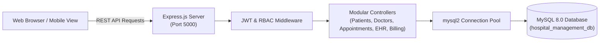

# Hospital Management System (HMS)

[](https://nodejs.org/)
[](https://expressjs.com/)
[](https://www.mysql.com/)
[](LICENSE)

An enterprise-grade, full-stack Hospital Management System (HMS) engineered to streamline clinical outpatient workflows, patient intake and electronic health records (EHR), physician appointment scheduling, department management, and revenue billing.

---

## 📌 Project Overview

Modern healthcare facilities require dependable, real-time coordination between front-desk operations, consulting physicians, clinical diagnostics, and pharmacy counters. The **Hospital Management System (HMS)** delivers a unified digital workspace designed to eliminate administrative overhead, prevent scheduling conflicts, ensure fast patient lookups, and provide transparent billing workflows.

The system features an asynchronous RESTful backend built with Node.js and Express, backed by a normalized relational MySQL schema with connection pooling, and paired with a responsive medical dashboard UI.

---

## 🚀 Features

- **Executive KPI Dashboard**: Real-time metrics tracking total patient registrations, daily scheduled appointments, on-duty consulting doctors, and collected OPD revenue.
- **Patient Intake & Registry**: Comprehensive patient demographics management with unique system identifiers (`PAT-XXXX`), blood group tracking, known allergy alerts, emergency contacts, and insurance carrier logs.
- **Doctor Directory & Schedules**: Physician profiles segmented by clinical department, consultation fees, assigned consultation suites, and day-wise shift availability.
- **Smart Appointment Scheduling**: Outpatient slot booking with automated token generation, conflict-free scheduling, and dynamic status progression (`Scheduled` &rarr; `Completed` &rarr; `Cancelled`).
- **Electronic Health Records (EHR)**: Clinical consultation notes, diagnostic summaries, vital sign telemetry (Blood Pressure, Heart Rate, Temperature, Weight), and digital prescription management.
- **Billing & Revenue Ledger**: Automated invoice calculation with itemized discounts, taxes, net amounts, and multi-mode payment settlement tracking (Cash, UPI, Cards, Insurance).
- **Role-Based Access Control (RBAC)**: Fine-grained endpoint authorization enforcing operational segregation between administrative and medical roles.
- **High-Availability Fallback**: Built-in zero-downtime relational data layer that gracefully maintains operational integrity even during local database maintenance.

---

## 👥 User Roles

The application enforces security and operational separation across 4 distinct user roles:

| Role | Access Level & Permissions |
|---|---|
| **Administrator** | Full system control: platform analytics, staff management, department configuration, fee structures, and audit records. |
| **Doctor / Physician** | Clinical access: view assigned appointments, inspect patient medical histories, record clinical notes, and issue digital prescriptions. |
| **Receptionist / Front Desk** | Operational access: patient intake registration, appointment scheduling, queue token allocation, and billing payment collection. |
| **Patient** | Self-service access: browse consulting physicians, request outpatient appointments, and view billing invoices. |

---

## 🛠️ Technologies Used

### Frontend
- **HTML5 & CSS3**: Custom clinical design system, flexbox/grid layouts, responsive typography.
- **JavaScript (ES6+)**: Asynchronous fetch API, client-side routing, DOM event management, and toast notifications.
- **Bootstrap Icons**: Vector icon library for healthcare data visualization.

### Backend
- **Node.js**: Asynchronous event-driven JavaScript runtime.
- **Express.js**: REST API routing, middleware chaining, and static asset delivery.
- **Helmet & CORS**: HTTP security header hardening and cross-origin resource sharing policy.
- **Morgan**: HTTP request logging for development and audit monitoring.

### Database & Security
- **MySQL 8.0**: Normalized relational database with foreign key constraints and indexed lookup queries.
- **mysql2/promise**: High-performance asynchronous connection pool.
- **JSON Web Tokens (JWT)**: Stateless authentication with role payload validation.
- **bcryptjs**: Salted password hashing (cost factor 10) for secure credential storage.

---

## 📐 System Architecture



For comprehensive Entity-Relationship (ER) diagrams and security specifications, see [docs/architecture.md](docs/architecture.md).

---

## 📁 Project Structure

```
hospital-management-system/
├── backend/
│   ├── config/
│   │   └── db.js                 # Database connection pool with resilient fallback
│   ├── controllers/
│   │   ├── appointmentController.js  # Booking, triage, and token allocation
│   │   ├── authController.js         # JWT issuance and session management
│   │   ├── billingController.js      # Invoicing, taxes, and payment recording
│   │   ├── doctorController.js       # Physician profiles and department filters
│   │   ├── patientController.js      # Patient registration and demographic lookups
│   │   ├── recordController.js       # EHR clinical diagnoses and prescriptions
│   │   └── statsController.js        # KPI aggregation for executive dashboard
│   ├── middleware/
│   │   └── auth.js               # JWT verification & Role-Based Access Control
│   ├── routes/                   # Express REST route handlers
│   │   ├── appointments.js
│   │   ├── auth.js
│   │   ├── billing.js
│   │   ├── doctors.js
│   │   ├── patients.js
│   │   ├── records.js
│   │   └── stats.js
│   └── server.js                 # Main server entry point
├── database/
│   ├── schema.sql                # Normalized MySQL DDL relational schema
│   └── seed.sql                  # Production-grade baseline demo records
├── frontend/
│   ├── index.html                # Single-page dashboard interface
│   ├── css/
│   │   └── app.css               # Healthcare UI design system & responsive styling
│   └── js/
│       ├── api.js                # Asynchronous API communication client
│       └── app.js                # State management, view rendering, and modals
├── docs/
│   ├── architecture.md           # System architecture & ER diagram documentation
│   └── api-documentation.md      # Complete REST API reference
├── scripts/
│   ├── setup-db.js               # Automated schema provisioning & data seeder
│   └── test-api.js               # Automated API test suite
├── .env.example                  # Environment configuration template
├── .gitignore                    # Production git ignore rules
├── LICENSE                       # MIT License
├── package.json                  # Dependencies and execution scripts
└── README.md                     # Project documentation
```

---

## ⚙️ Installation & Setup

### 1. Prerequisites
- **Node.js**: v18.0.0 or higher
- **MySQL**: 8.0+ service running locally (Default port `3306` or `3305`)

### 2. Clone the Repository
```bash
git clone https://github.com/saro053-prog/hospital-management-system.git
cd hospital-management-system
```

### 3. Install Dependencies
```bash
npm install
```

### 4. Configure Environment Variables
Copy the example environment file and customize your settings:
```bash
cp .env.example .env
```

Configure your `.env` file:
```env
PORT=5000
NODE_ENV=development

# MySQL Database Configuration
DB_HOST=localhost
DB_PORT=3306
DB_USER=root
DB_PASSWORD=your_mysql_password_here
DB_NAME=hospital_management_db

# Security & Authentication
JWT_SECRET=your_super_secret_jwt_key_here
JWT_EXPIRES_IN=24h
```

### 5. Provision the Database
Run the automated schema creation and data seeding script:
```bash
npm run setup-db
```
*This command creates the database `hospital_management_db`, constructs all 10 relational tables, hashes passwords with bcrypt, and seeds initial clinical departments, physicians, patients, and sample appointments.*

---

## 🚦 Running the Project

Start the application:
```bash
# Production start
npm start

# Development mode (with live reload)
npm run dev
```

Access the application in your browser:
- **Web Dashboard**: [http://localhost:5000](http://localhost:5000)
- **API Health Check**: [http://localhost:5000/api/health](http://localhost:5000/api/health)

---

## 🔑 Demo Credentials for Testing

Use any of the following accounts to test role-specific dashboard views:

| Role | Email | Password | Primary Purpose |
|---|---|---|---|
| **Administrator** | `admin@hospital.org` | `Password@123` | Full dashboard metrics & oversight |
| **Cardiologist** | `dr.sharma@hospital.org` | `Password@123` | Doctor schedule, consults & EHR |
| **Receptionist** | `receptionist@hospital.org` | `Password@123` | Patient intake, appointments & billing |
| **Patient** | `arun@example.com` | `Password@123` | Personal profile & booking |

> **Pro-Tip**: You can switch between active test roles in one click using the **"Switch Role"** button in the dashboard top navigation bar!

---

## 📡 API Overview

A quick reference of available REST endpoints:

- `POST /api/auth/login` — Authenticate credentials & issue JWT
- `GET  /api/auth/me` — Retrieve active session user details
- `GET  /api/stats/dashboard` — Aggregate hospital operational KPIs
- `GET  /api/patients` — List patients with search filtering
- `POST /api/patients` — Register a new patient
- `GET  /api/doctors` — List physicians filtered by department
- `GET  /api/doctors/departments` — List clinical specialties
- `GET  /api/appointments` — List scheduled outpatient visits
- `POST /api/appointments` — Book a new consultation slot
- `PUT  /api/appointments/:id/status` — Update appointment triage status
- `GET  /api/records` — Fetch patient EHR medical records
- `POST /api/records` — Create examination record & prescriptions
- `GET  /api/billing` — Retrieve outpatient invoices
- `POST /api/billing/:id/pay` — Settle invoice payment

*For full request/response schemas, refer to [docs/api-documentation.md](docs/api-documentation.md).*

---

## 🧪 Testing

Run the automated API test suite:
```bash
npm test
```
The suite verifies endpoint availability, payload formats, and status codes across all primary modules.

---

## 🔮 Future Improvements

- [ ] In-app WebRTC video consultation for telemedicine sessions.
- [ ] Automated SMS / WhatsApp appointment reminders via Twilio or Gupshup.
- [ ] Integration with HL7 / FHIR data standards for national health exchange interoperability.
- [ ] Barcode / RFID tracking for pharmacy inventory and inpatient medication administration.
- [ ] Bed allocation and ICU occupancy management module.

---

## 👤 Author

**V. Saravanapandi**  
- GitHub: [@saro053-prog](https://github.com/saro053-prog)
- LinkedIn: [https://www.linkedin.com/in/saravana-pandi-6133a5344](https://www.linkedin.com/in/saravana-pandi-6133a5344)
- Email: [msaravana791@gmail.com](mailto:msaravana791@gmail.com)
