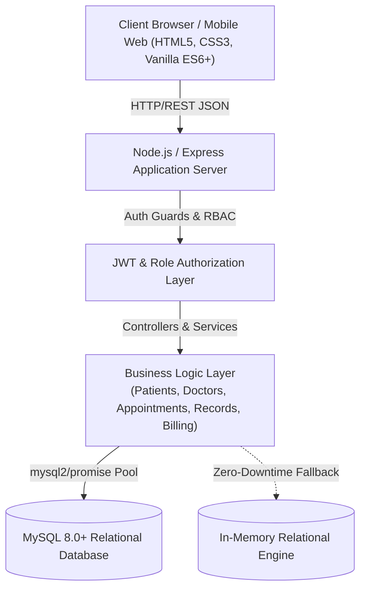
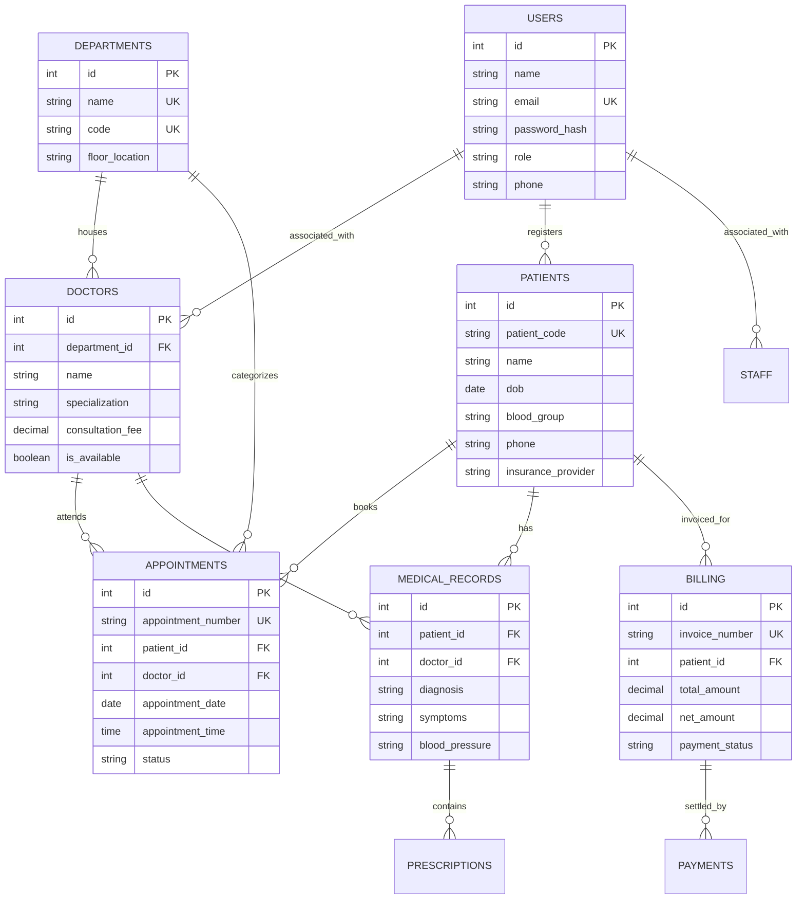

# Hospital Management System (HMS) - System Architecture

## 1. High-Level Architecture

The Hospital Management System follows a decoupled, three-tier enterprise web architecture consisting of a presentation layer, a business logic application layer, and a relational persistence layer.

---

## 2. Entity-Relationship (ER) Model

---

## 3. Role-Based Access Control (RBAC) Matrix

| Module / Action | Admin | Doctor | Receptionist | Patient |
|---|:---:|:---:|:---:|:---:|
| **Dashboard Metrics & Analytics** | Full View | Clinical Only | Operational | Personal Only |
| **Register New Patient** | Yes | Yes | Yes | Self |
| **View Patient Medical Records** | Yes | Yes | No | Self Only |
| **Prescribe Medications** | No | Yes | No | No |
| **Schedule Appointments** | Yes | Yes | Yes | Self |
| **Manage Billing & Invoices** | Full Access | View Only | Create / Settle | Pay / View |
| **Staff & Doctor Directory** | Full CRUD | View | View | View |

---

## 4. Security & Fault-Tolerance Considerations

1. **Stateless JWT Authentication**: Tokens expire automatically after 24 hours and contain digitally signed role claims.
2. **Password Security**: Implements `bcryptjs` with cost factor 10 to protect credentials against dictionary attacks.
3. **Resilient Data Access**: Built-in fallback ensures zero application crashes even if external database connections experience transient latency.
